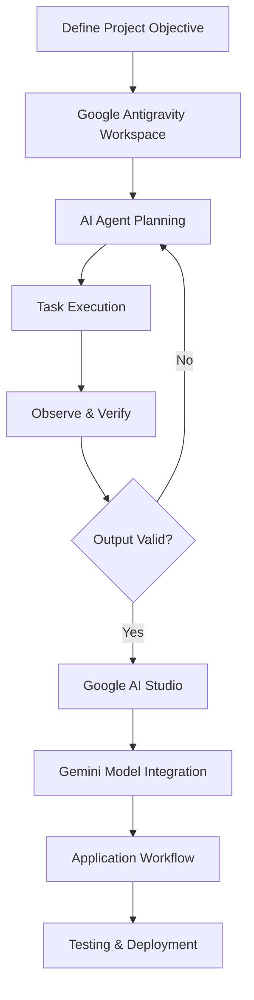

# 🚀 Build with AI | Google Antigravity & Google AI Studio

## 📌 Project Overview

This repository documents my hands-on learning and practical project work from Google's **Build with AI** workshop, focused on exploring the next generation of AI-powered software development.

The workshop introduced an agent-first approach to software engineering, combining **Google Antigravity** as an AI-powered development environment with **Google AI Studio** and the Gemini ecosystem for building and experimenting with intelligent applications.

The primary objective was to understand how AI agents can go beyond conventional conversational interactions and actively contribute to software development by planning tasks, interacting with project files, executing workflows, and assisting with multi-step problem-solving.

Through this experience, I explored how developers can transition from traditional manual coding towards more intelligent, automated, and agent-driven development workflows.

## 🎯 Project Objectives

- Understand the fundamentals of agentic AI and AI-assisted software engineering.
- Explore Google Antigravity as an AI-powered development workspace.
- Experiment with Gemini models through Google AI Studio.
- Understand multi-step task execution and autonomous agent workflows.
- Explore AI-assisted coding, debugging, and project orchestration.
- Understand the application development lifecycle, from prototyping to deployment.

## 🛠️ Workshop Activities & Implementation

### Phase 1: Exploring Google Antigravity

**1. Understanding the Development Environment**

Explored the core components of Google Antigravity:

- **Agent Manager:** Managing and orchestrating AI agents.
- **Editor:** Working with project files and AI-assisted coding.
- **Browser:** Supporting browser-based exploration and verification.
- **Artifacts:** Reviewing outputs and deliverables generated during agent workflows.

**2. Understanding Agentic Architecture**

Explored the agentic development cycle:

`Plan → Act → Observe → Verify`

This approach enables AI agents to break down complex instructions into smaller tasks, execute actions, observe the results, and validate their outputs.

**3. AI-Powered Workspace Configuration**

Explored how workspace context, project-level instructions, and prompt configurations help AI agents understand the codebase and work across multiple files.

### Phase 2: Building with Google AI Studio

**1. Gemini Model Experimentation**

Worked with Google AI Studio to explore AI application development and model experimentation.

Key activities included:

- Exploring Google AI Studio Build Mode.
- Experimenting with Gemini-powered application workflows.
- Configuring system instructions.
- Testing and evaluating model responses.
- Understanding how the Gemini API can be integrated into applications.

**2. Autonomous AI Agents & Workflow Automation**

Explored how AI agents can support multi-step development workflows, including:

- Task planning and execution.
- Dynamic project-file management.
- AI-assisted code generation and modification.
- Tool and API interaction workflows.
- Reviewing and validating generated outputs.

**3. Application Development Workflow**

Explored the end-to-end development process, including frontend and backend integration, environment configuration, API key management, and application deployment workflows.

---

## 🧰 Technology Stack

| Technology | Purpose |
|---|---|
| Google Antigravity | Agentic development environment |
| Google AI Studio | AI application prototyping |
| Gemini API | Large Language Model integration |
| AI Agents | Task planning and workflow execution |
| Prompt Engineering | System instructions and context management |
| API Integration | Connecting AI capabilities with applications |
| Environment Variables | Secure configuration management |

*Note: Application-specific programming languages, frameworks, and hosting services depend on the implementation included in this repository.*

## 🧠 Key Concepts Explored

### 1. Agentic AI Development

Understanding how AI agents can independently plan, execute, and verify tasks instead of simply responding to individual prompts.

### 2. Context-Aware Development

Exploring how providing structured workspace instructions and project context improves the relevance and consistency of AI-generated outputs.

### 3. AI-Powered Workflow Automation

Understanding how repetitive and multi-step development activities can be assisted through intelligent agents and integrated tools.

### 4. Human-AI Collaboration

Learning that effective AI development is not about removing human involvement. It is about combining human decision-making, supervision, and validation with AI-driven execution.

## 🔄 Conceptual Workflow



## 💡 Key Learnings & Takeaways

- **Agent-First Engineering:** Understanding the shift from manually writing every line of code to directing and supervising intelligent agents.
- **Practical AI Integration:** Exploring how Gemini models can be incorporated into application development workflows.
- **Workflow Automation:** Understanding how agents can manage complex, multi-step tasks.
- **Prompt Engineering:** Learning the importance of structured instructions and contextual information.
- **Responsible AI Development:** Recognizing the importance of testing, human oversight, output validation, and secure API key management.
- **Rapid Prototyping:** Understanding how AI-powered development tools can accelerate experimentation and application development.

## 🔐 Security & Best Practices

When working with AI APIs and application credentials:

- Store API keys in environment variables.
- Never upload private API keys or credentials to public GitHub repositories.
- Use a `.env.example` file to document required environment variables.
- Add `.env` and other sensitive files to `.gitignore`.
- Validate AI-generated code and outputs before using them in production.

## 📂 Repository Structure

The following is a suggested structure for organizing the project materials:

```text
build-with-ai-antigravity/
│
├── src/                  # Application source code
├── prompts/              # System instructions and prompts
├── assets/               # Screenshots and project resources
├── .env.example          # Environment variable template
├── .gitignore            # Excluded files and credentials
└── README.md             # Project documentation
```

### Setup

**1. Clone the repository**

```bash
git clone https://github.com/27-omdeepchaudhary-sudo/build-with-ai-antigravity.git

cd build-with-ai-antigravity
```

**2. Configure environment variables**

If the application uses the Gemini API, create a `.env` file:

```env
GEMINI_API_KEY=your_api_key_here...(AQ.Ab8RN6Io1_5h_tXMeqVwLJG9SqZ2fUAgYu7kP0PrMLCdgrCqdw)
```

**3. Install dependencies**

Install the dependencies according to the project's package manager and dependency file.

**4. Run the application**

Follow the project-specific execution instructions once the application framework and entry point are configured.

---

## 🌱 Future Scope

Potential areas for further exploration:

- Developing more sophisticated multi-agent systems.
- Integrating additional tools and external APIs.
- Building context-aware AI assistants.
- Improving agent validation and error-handling mechanisms.
- Exploring advanced AI-powered business process automation.
- Developing practical AI solutions for real-world business problems.
